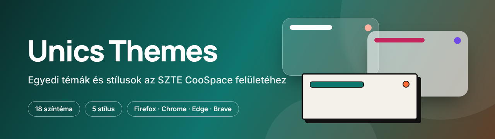
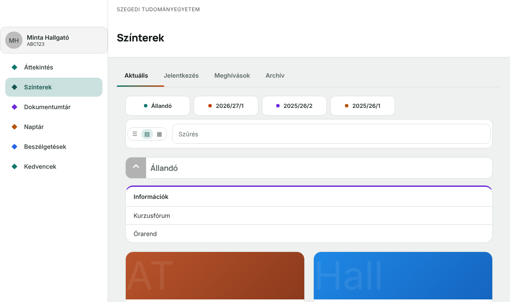
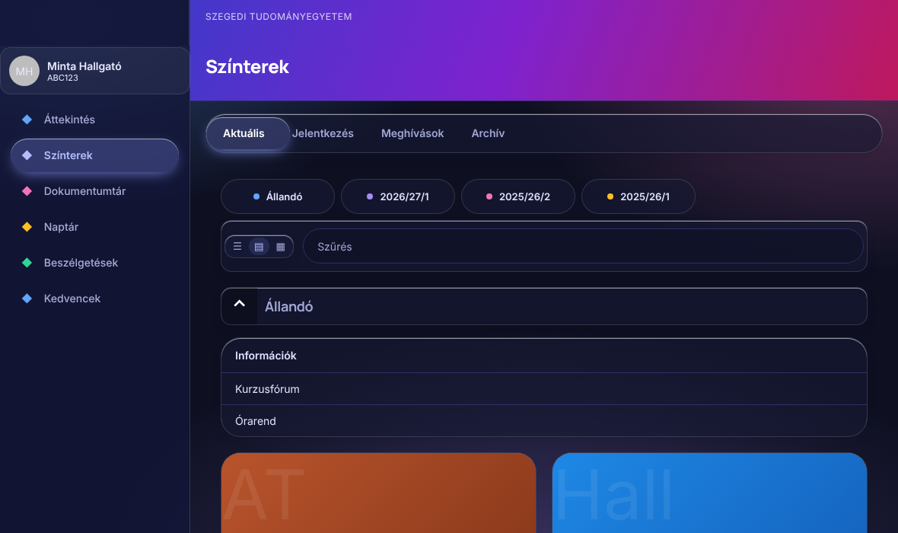
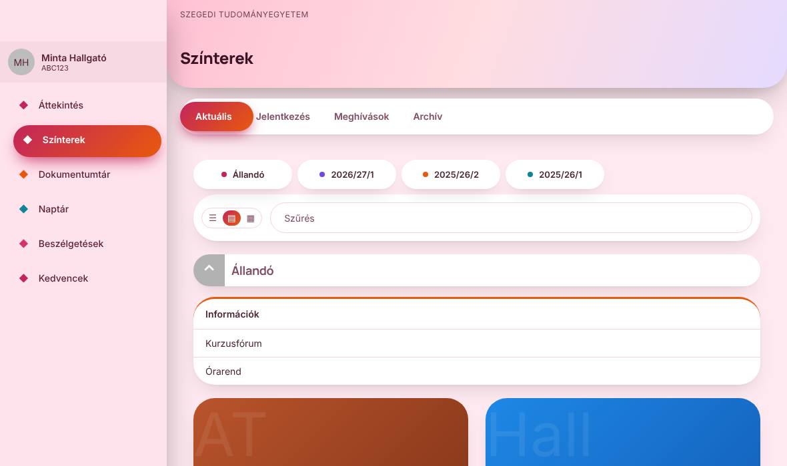
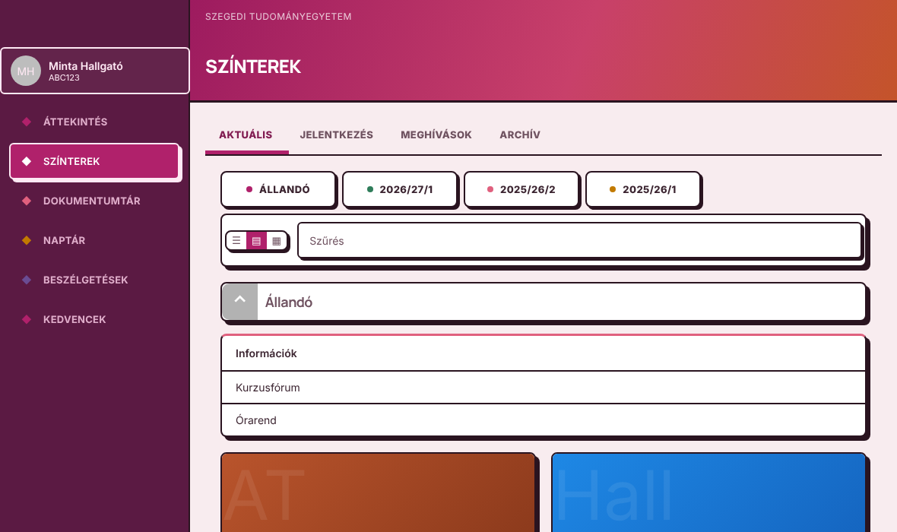
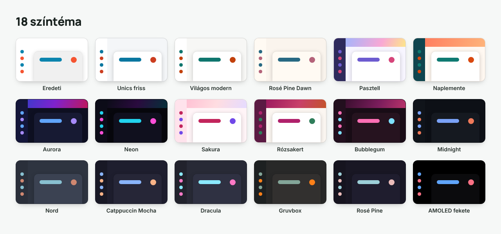

<div align="center">



**Válaszd ki, hogyan nézzen ki az SZTE Unics (CooSpace)!**
18 színtéma · 5 stílus · egy kattintás

[](LICENSE)
[](https://github.com/zoltan-234/coospace5-egyedi-temak-szte/releases/latest)

**[⬇️ Letöltés](https://github.com/zoltan-234/coospace5-egyedi-temak-szte/releases/latest)** · **[📖 Telepítési útmutató (PDF)](docs/utmutato-hu.pdf)** · **[🇬🇧 English](README.en.md)** · **[🐞 Hibabejelentés](https://github.com/zoltan-234/coospace5-egyedi-temak-szte/issues/new/choose)**

<a href="https://github.com/zoltan-234/coospace5-egyedi-temak-szte/releases/latest"></a> <a href="https://github.com/zoltan-234/coospace5-egyedi-temak-szte/releases/latest"></a> <a href="https://github.com/zoltan-234/coospace5-egyedi-temak-szte/releases/latest"></a> <a href="https://github.com/zoltan-234/coospace5-egyedi-temak-szte/releases/latest"></a> <a href="https://github.com/zoltan-234/coospace5-egyedi-temak-szte/releases/latest"></a> <a href="https://github.com/zoltan-234/coospace5-egyedi-temak-szte/releases/latest"></a>

</div>

---

## Mi ez?

Egy kis böngészőbővítmény, amivel átszabhatod az **Unics (CooSpace)** kinézetét: színeket, formákat, animációkat. Akár sötét módot, akár rózsaszínt, akár üveg-hatású felületet szeretnél, a bővítmény ikonjára kattintva egy popupban választasz, és a változás **azonnal** látszik. A választásod megmarad F5 és újraindítás után is.

> 🛡️ **Nem kell aggódni:** a bővítmény **csak a megjelenést** módosítja, csak a `unics.szte.hu` oldalon fut, **semmit nem küld el sehova**, és nem ír az Unicsba. Részletek: [Adatvédelem](PRIVACY.md).

## Stílusok

A színtémától független forma-réteg. Bármelyik színnel kombinálható.

| | |
|:--:|:--:|
|  **Modern**<br>Tiszta, lekerekített, finom árnyékok |  **Üveg**<br>Áttetsző, elmosott panelek |
|  **Szigetek**<br>Lebegő, pirula-alakú elemek, rugalmas mozgás |  **Brutalista**<br>Vastag keret, kemény árnyék |

A **Klasszikus** stílus az Unics eredeti formáit tartja meg, csak a színeket cseréli.

## Színtémák



**Világos:** Eredeti · Unics friss · Világos modern · Rosé Pine Dawn
**Többszínű:** Pasztell · Naplemente · Aurora · Neon
**Rózsaszín:** Sakura · Rózsakert · Bubblegum
**Sötét:** Midnight · Nord · Catppuccin Mocha · Dracula · Gruvbox · Rosé Pine · AMOLED fekete

Minden téma 5 színű palettát kap: ettől színesek a menüikonok, a félév-gombok pöttyei, a kezdőlap dobozainak fejlécei és a naptáresemények. A szövegek kontrasztját a generátor ellenőrzi (WCAG 4.5:1).

## Telepítés

Töltsd le a legújabb kiadást: **[Releases](https://github.com/zoltan-234/coospace5-egyedi-temak-szte/releases/latest)**

| Böngésző | Fájl | Hogyan |
|---|---|---|
| **Firefox** | `.xpi` | Nyisd meg a fájlt a Firefoxban → **Hozzáadás**. Tartós, magától frissül. A popupban nyomd meg egyszer az **Engedélyezés** gombot. |
| **Chrome** | `…-chromium.zip` | Csomagold ki egy **állandó** mappába → `chrome://extensions` → **Fejlesztői mód** → **Kicsomagolt bővítmény betöltése** |
| **Edge** | `…-chromium.zip` | Ugyanígy: `edge://extensions` |
| **Brave** | `…-chromium.zip` | Ugyanígy: `brave://extensions` |
| **Más Chromium-alapú böngészők** (Vivaldi, Opera, Opera GX, Chromium) | `…-chromium.zip` | Ugyanígy: `vivaldi://extensions`, `opera://extensions`, `chrome://extensions` |

> ⚠️ Chrome, Edge és Brave esetén a kicsomagolt mappát **ne töröld és ne helyezd át**, különben a bővítmény leáll.

> A Chromium-alapú böngészők (Vivaldi, Opera stb.) elvileg ugyanígy működnek, de ezeket nem teszteltem. Ha valamelyiknél gond van, jelezd egy [Issue](../../issues)-ban.

📖 Képes, lépésről lépésre útmutató: **[utmutato-hu.pdf](docs/utmutato-hu.pdf)** ([Markdown](docs/UTMUTATO.md)) · **[guide-en.pdf](docs/guide-en.pdf)** ([Markdown](docs/GUIDE.md))

A Safarit és a telefonos böngészőket egyelőre nem támogatja.

## Gyakori kérdések

<details><summary><b>Biztonságos?</b></summary>

Igen. A bővítmény csak a megjelenést állítja (CSS), csak a `unics.szte.hu` oldalon fut, nincs szervere, nem küld el adatot, és nem fér hozzá más oldalakhoz. A teljes forráskód nyilvános, bárki ellenőrizheti. Egyetlen engedélye a `storage` (a választott téma mentése) és az Unics oldalhoz való hozzáférés.
</details>

<details><summary><b>Hogyan állítom vissza az eredetit?</b></summary>

Válaszd a **Világos → Eredeti** színt és a **Klasszikus** stílust. Vagy kapcsold ki a bővítményt, az oldal azonnal visszaáll.
</details>

<details><summary><b>Miért kell Firefoxban az „Engedélyezés” gomb?</b></summary>

A Firefox alapból nem adja meg a bővítményeknek az oldalhoz való hozzáférést, azt egyszer meg kell erősíteni. Chrome-ban, Edge-ben és Bravében ez telepítéskor megvan.
</details>

<details><summary><b>Valami rosszul néz ki</b></summary>

Küldj egy képernyőképet a [hibabejelentő](https://github.com/zoltan-234/coospace5-egyedi-temak-szte/issues/new/choose) oldalon, és írd meg, melyik téma és stílus. Addig válts másik témára.
</details>

<details><summary><b>Hivatalos az SZTE-től?</b></summary>

Nem. Független, nem hivatalos projekt, nem áll kapcsolatban az SZTE-vel vagy az Unics fejlesztőivel.
</details>

## Fejlesztőknek

```
manifest.json              MV3, közös Firefox + Chromium
content/                   téma betöltése, jss-feloldó, felület-jelölő
popup/                     témaválasztó felület
themes/ , themes.json      színtémák (a build-themes.py generálja)
layouts/ , layouts.json    stílusok (a modern.css az alap, a többi src/-ből generálódik)
fonts/                     Inter és Manrope (OFL licenc)
docs/                      útmutató (PDF + Markdown), Unics elemek (ELEMEK.md)
tools/                     generátorok, build, szkennelő szkriptek
.github/workflows/         automatikus kiadás
```

```bash
python3 tools/build-themes.py     # témák generálása (kontraszt-ellenőrzéssel)
python3 tools/build-layouts.py    # stílusok generálása
bash tools/build.sh               # csomagok a dist/ mappába (Firefox + Chromium)
python3 tools/build-guide.py      # útmutató PDF-ek
python3 tools/build-assets.py     # README-képek
```

- **Új téma:** vedd fel a `tools/build-themes.py` `THEMES` listájába, futtasd, töltsd újra a bővítményt.
- **Új stílus:** `layouts/src/<id>.css` + a `tools/build-layouts.py` listája + `layouts.json`.
- **Az Unics elemei és szelektorai:** [`docs/ELEMEK.md`](docs/ELEMEK.md). Az Unics generált `jss…` osztályait ne használd, a `jss-resolver.js` stabil `data-ut` jelölést ad helyettük.
- Részletek: [CONTRIBUTING.md](CONTRIBUTING.md) · Forrás és építés: [BUILD.md](BUILD.md) · Változások: [CHANGELOG.md](CHANGELOG.md)

## Licenc

[PolyForm Noncommercial 1.0.0](LICENSE): szabadon használható, másolható és módosítható **nem kereskedelmi célra**, de pénzt keresni vele nem lehet. A betűtípusok (Inter, Manrope) az SIL OFL licenc alatt állnak. Magyar összefoglaló: [NOTICE.md](NOTICE.md).

<sub>Nem hivatalos projekt. Az Unics és a CooSpace nevek a tulajdonosaikéi.</sub>
