# Unics Themes – telepítési útmutató

Egyedi témák az SZTE Unics (CooSpace) felületéhez  
Verzió 0.6.0 · English version: GUIDE.md

## Tartalom

1. [Mi ez, és mire jó?](#1-mi-ez-és-mire-jó)
2. [Melyik böngészőt használod?](#2-melyik-böngészőt-használod)
3. [A fájl letöltése](#3-a-fájl-letöltése)
4. [Telepítés Firefoxban](#4-telepítés-firefoxban)
5. [Telepítés Chrome-ban](#5-telepítés-chrome-ban)
6. [Telepítés Edge-ben](#6-telepítés-edge-ben)
7. [Telepítés Brave-ben](#7-telepítés-brave-ben)
8. [Használat](#8-használat)
9. [Amikre figyelj](#9-amikre-figyelj)
10. [Frissítés](#10-frissítés)
11. [Hibaelhárítás](#11-hibaelhárítás)
12. [Eltávolítás](#12-eltávolítás)
13. [Licenc, hibabejelentés](#13-licenc-hibabejelentés)

## 1. Mi ez, és mire jó?

Az **Unics Themes** egy kis böngészőbővítmény az SZTE **Unics (CooSpace)** felületéhez. Segítségével kiválaszthatod, hogyan nézzen ki az oldal: 18 színtéma (világos, színes, rózsaszín, sötét) és 5 stílus (Klasszikus, Modern, Üveg, Szigetek, Brutalista) közül, és tetszőlegesen kombinálhatod őket.

- A választásod **megmarad** frissítés (F5) és a böngésző újraindítása után is.
- Egy kattintással váltasz: a bővítmény ikonjára kattintva megnyílik a választó ablak.
- Ingyenes, és bármikor kikapcsolható vagy eltávolítható.

> ✅ **Nem kell aggódnod: ez csak a kinézetet változtatja**  
> A bővítmény **kizárólag az oldal megjelenését** módosítja (színek, formák, animációk). Biztonságos, mert:

- **Csak az unics.szte.hu oldalon fut**, más weboldalhoz nem fér hozzá.
- **Nem küld el semmit sehova**: nincs szervere, nincs követés, nincs statisztika. A választott téma csak a saját böngésződben tárolódik.
- **Nem módosítja az Unics adatait**: nem ír, nem küld be semmit, nem érinti a jegyeidet, üzeneteidet vagy beadandóidat. Ha kikapcsolod, minden pontosan olyan, mint előtte.
- **Nem kér jelszót**, és nem fér hozzá a böngésződ jelszavaihoz, előzményeihez vagy más füleihez.
- **Nyílt a forráskód**: a teljes kód megtekinthető a GitHubon, bárki ellenőrizheti.
- **Nem hivatalos** projekt, nem áll kapcsolatban az SZTE-vel vagy az Unics fejlesztőivel.

Technikai pontosság kedvéért: a bővítménynek az Unics oldalon futnia kell, hogy átszínezhesse azt. Ezt a böngésző külön engedélyhez köti (lásd a telepítési részt). Az oldal tartalmát nem olvassa ki és nem továbbítja, csak a megjelenést (színeket, méreteket) állítja.

## 2. Melyik böngészőt használod?

A telepítés böngészőnként kicsit más. Keresd meg a sajátodat a táblázatban, majd ugorj a hozzá tartozó fejezetre.

| Böngésző | Telepítés módja | Marad újraindítás után? | Automatikus frissítés |
|---|---|---|---|
| **Firefox** | Aláírt .xpi fájl, egy kattintás | Igen | Igen (naponta) |
| **Chrome** | Kicsomagolt mappa betöltése | Igen, ha a mappa a helyén marad | Nem, kézzel |
| **Edge** | Kicsomagolt mappa betöltése | Igen, ha a mappa a helyén marad | Nem, kézzel |
| **Brave** | Kicsomagolt mappa betöltése | Igen, ha a mappa a helyén marad | Nem, kézzel |

> ℹ️ **Telefonon és tableten**  
> Androidos Chrome, Edge és Brave nem támogat bővítményeket, ezért ott nem használható. Az Android-Firefoxon nem teszteltük, nem ajánlott. A bővítmény asztali gépre (Windows, macOS, Linux) készült.

## 3. A fájl letöltése

Minden kiadás a GitHub **Releases** oldalán található: `https://github.com/zoltan-234/coospace5-egyedi-temak-szte/releases/latest`

1. Nyisd meg a fenti oldalt. Az **Assets** (Fájlok) listában két fájlt látsz.

   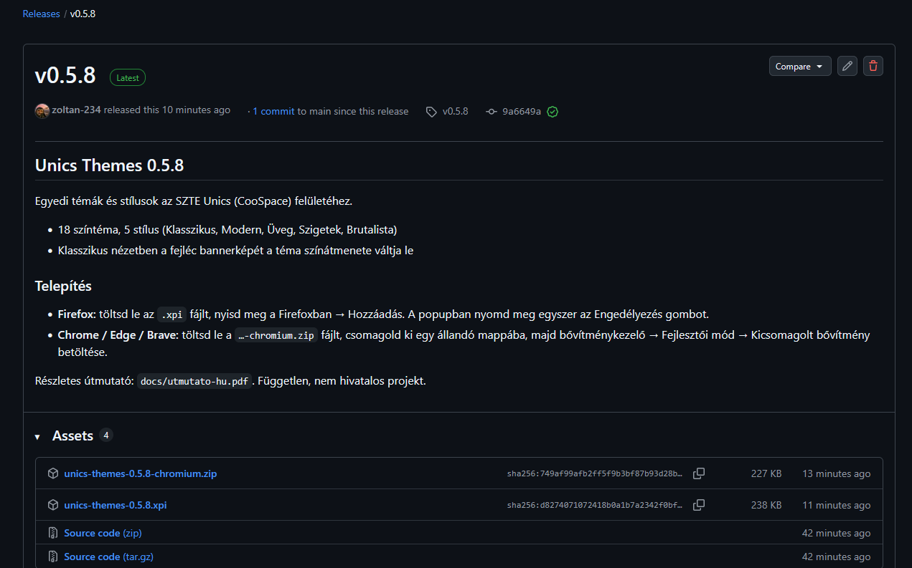
   *A GitHub Releases oldal: itt tölthető le a két fájl*
   
2. **Firefox-hoz** az `.xpi` végű fájlt töltsd le (pl. `unics-themes-0.5.8.xpi`).
3. **Chrome-hoz, Edge-hez és Brave-hez** a `…-chromium.zip` fájlt töltsd le.

   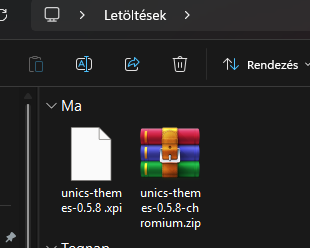
   *A letöltött fájlok: az .xpi és a -chromium.zip*
   

## 4. Telepítés Firefoxban

> ✅ **Ez a legkényelmesebb**  
> A Firefox-verzió a Mozilla által **aláírt**, ezért egyszerűen telepíthető, tartósan megmarad, és magától frissül.

1. Töltsd le az `.xpi` fájlt a Releases oldalról (lásd a 3. fejezetet): kattints a hivatkozásra, vagy nyisd meg a letöltött fájlt.
2. A Firefox megkérdezi, engedélyezed-e a **github.com**-nak, hogy kiegészítőt telepítsen. Kattints a **Telepítés folytatása** gombra.

   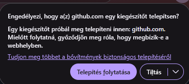
   *Firefox: a github.com telepítési engedélye*
   
3. Megjelenik az **Unics Themes hozzáadása** ablak. Itt látod, mit kér a bővítmény: csak az `unics.szte.hu` oldalon lévő adatok elérését, és hogy nem gyűjt adatot. Kattints a **Hozzáadás** gombra.

   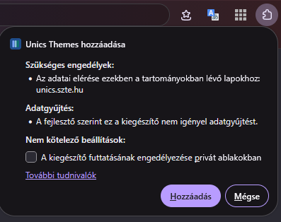
   *Firefox: az Unics Themes hozzáadása, a kért engedélyekkel*
   
4. Ellenőrizd: a `about:addons` oldalon az **Unics Themes** a bővítmények között látszik, bekapcsolva.

   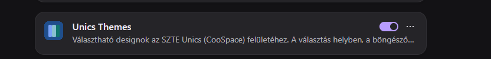
   *Firefox: a bővítmény a kiegészítők listájában*
   
5. Adj hozzáférést az Unics oldalhoz (Firefoxban ezt külön meg kell tenni, egyszer): kattints jobb gombbal a bővítmény ikonjára, és válaszd a **Mindig engedélyezve a következőkön: unics.szte.hu** lehetőséget. Ugyanitt tűzheted ki az ikont az eszköztárra (**Rögzítés az eszköztárra**). A bővítmény popupjában is van egy **Engedélyezés** gomb, az ugyanezt teszi.

   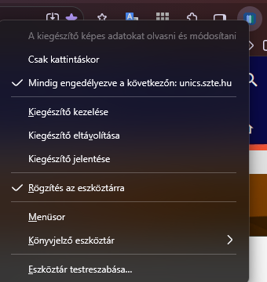
   *Firefox: az ikon menüje: hozzáférés az Unics oldalhoz, kitűzés, eltávolítás*
   
6. Nyisd meg az Unics oldalt, kattints az ikonra, és válassz színt és stílust. A változás azonnal látszik.

> ℹ️ **Frissítés**  
> A Firefox naponta egyszer ellenőrzi, van-e újabb verzió, és magától frissít. Azonnali kereséshez: `about:addons` → fogaskerék → **Bővítmények frissítéseinek keresése**.

## 5. Telepítés Chrome-ban

> ⚠️ **Fontos: a mappa a bővítmény helye**  
> A Chrome a letöltött mappából olvassa a fájlokat, nem másolja át. Ezért a mappát **ne töröld és ne helyezd át**, különben a bővítmény leáll.

1. Töltsd le a `…-chromium.zip` fájlt (3. fejezet), és **csomagold ki egy állandó helyre**, pl. `Dokumentumok\unics-themes`. Jobb klikk → **Összes kibontása**. A kicsomagolt mappában közvetlenül ott kell lennie a `manifest.json` fájlnak.
2. Nyisd meg a bővítménykezelőt: a Chrome menüje (⋮) → **Bővítmények** → **Bővítmények kezelése**. (Vagy írd a címsorba: `chrome://extensions`.)

   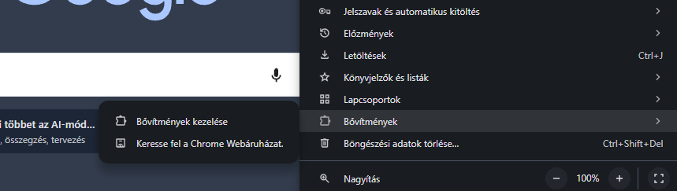
   *Chrome: a menü → Bővítmények → Bővítmények kezelése*
   
3. Kapcsold be jobb felül a **Fejlesztői módot**, majd kattints a **Kicsomagolt elemek betöltése** gombra.

   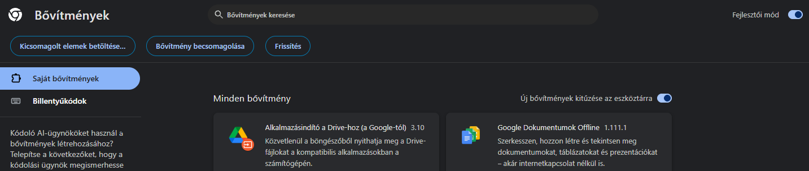
   *Chrome: a bővítménykezelő, bekapcsolt fejlesztői móddal és a betöltés gombbal*
   
4. Válaszd ki a kicsomagolt mappát, és kattints a **Mappaválasztás** gombra.

   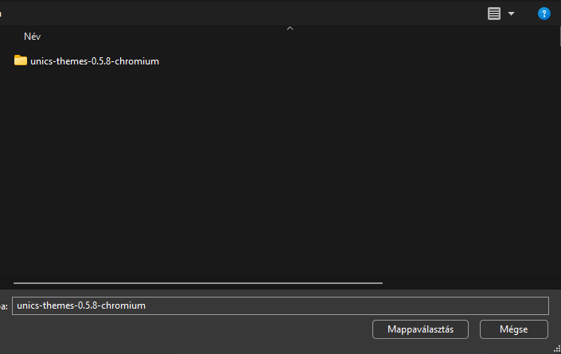
   *A mappaválasztó ablak: válaszd ki a kicsomagolt mappát*
   
5. Az **Unics Themes** megjelenik a listában, hibajelzés nélkül.

   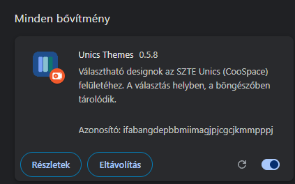
   *Chrome: a betöltött bővítmény kártyája*
   
6. Tűzd ki az ikont: puzzle ikon → az Unics Themes melletti tűzőcsap.

   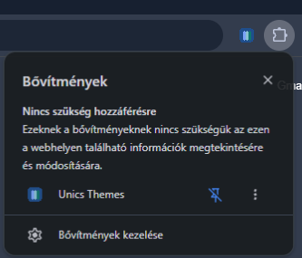
   *Chrome: a bővítmény kitűzése az eszköztárra*
   
7. Nyisd meg az Unics oldalt, kattints az ikonra, és válassz témát (lásd a 8. fejezetet).

> ℹ️ **Nem kell az „Engedélyezés” gomb**  
> Chrome-ban, Edge-ben és Brave-ben az oldalhoz való hozzáférés telepítéskor már megvan, a Firefoxtól eltérően.

## 6. Telepítés Edge-ben

> ⚠️ **Fontos: a mappa a bővítmény helye**  
> Az Edge is a kicsomagolt mappából olvassa a fájlokat. A mappát **ne töröld és ne helyezd át**.

1. Töltsd le a `…-chromium.zip` fájlt (3. fejezet), és csomagold ki egy állandó helyre.
2. Nyisd meg a bővítménykezelőt: az Edge menüje (⋯) → **Bővítmények** → **Bővítmények kezelése**. (Vagy: `edge://extensions`.)

   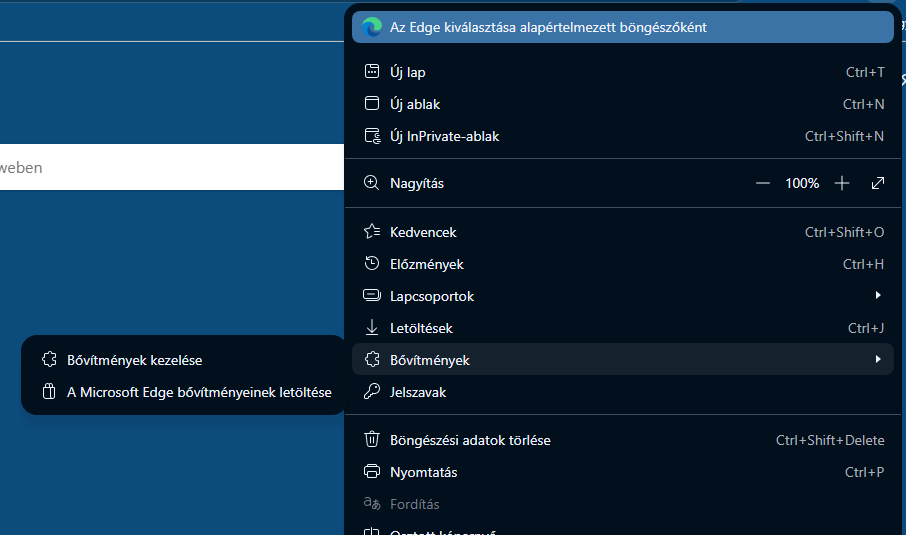
   *Edge: a menü → Bővítmények → Bővítmények kezelése*
   
3. Kapcsold be a bal alsó sarokban a **Fejlesztői módot**, majd kattints a **Kicsomagolt bővítmény betöltése** gombra.

   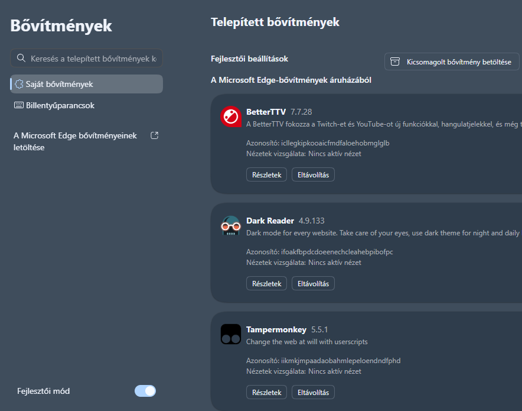
   *Edge: a bővítménykezelő, bekapcsolt fejlesztői móddal és a betöltés gombbal*
   
4. Válaszd ki azt a mappát, amiben a `manifest.json` van (ugyanaz a mappaválasztó ablak, mint Chrome-ban).

   
   *A mappaválasztó ablak: válaszd ki a kicsomagolt mappát*
   
5. Az **Unics Themes** megjelenik a listában, hibajelzés nélkül.

   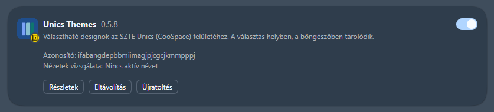
   *Edge: a betöltött bővítmény kártyája*
   
6. Tűzd ki az ikont az eszköztárra: Bővítmények (puzzle) menü → az Unics Themes melletti tűzőcsap.

   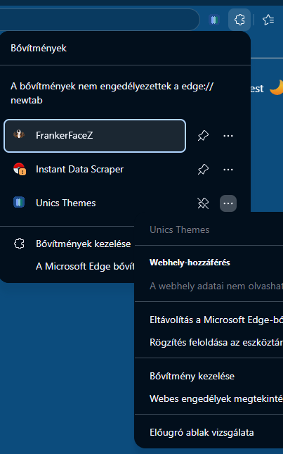
   *Edge: kitűzés az eszköztárra és eltávolítás a bővítmények menüjéből*
   
7. Nyisd meg az Unics oldalt, és válassz témát (8. fejezet).

## 7. Telepítés Brave-ben

> ⚠️ **Fontos: a mappa a bővítmény helye**  
> A Brave is a kicsomagolt mappából olvassa a fájlokat. A mappát **ne töröld és ne helyezd át**.

1. Töltsd le a `…-chromium.zip` fájlt (3. fejezet), és csomagold ki egy állandó helyre.
2. Nyisd meg a bővítménykezelőt: a Brave menüje (☰) → **Bővítmények** → **Bővítmények kezelése**. (Vagy: `brave://extensions`.)

   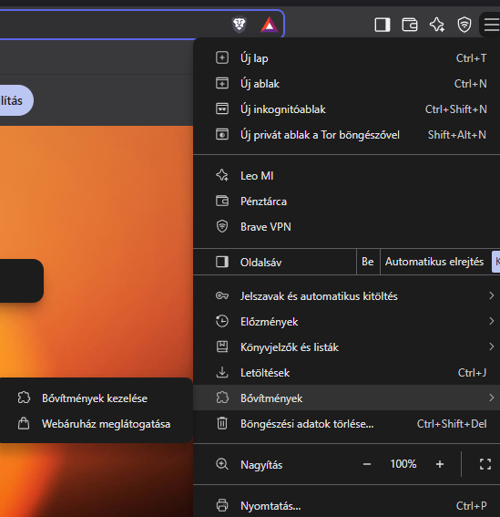
   *Brave: a menü → Bővítmények → Bővítmények kezelése*
   
3. Kapcsold be jobb felül a **Fejlesztői módot**, majd kattints a **Kicsomagolt elemek betöltése** gombra.

   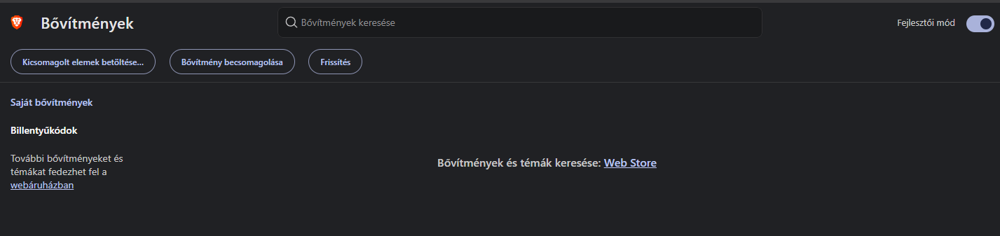
   *Brave: a bővítménykezelő, bekapcsolt fejlesztői móddal és a betöltés gombbal*
   
4. Válaszd ki azt a mappát, amiben a `manifest.json` van (ugyanaz a mappaválasztó ablak, mint Chrome-ban).

   
   *A mappaválasztó ablak: válaszd ki a kicsomagolt mappát*
   
5. Az **Unics Themes** megjelenik a listában, hibajelzés nélkül.

   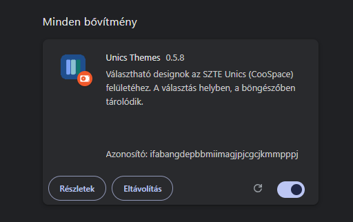
   *Brave: a betöltött bővítmény kártyája*
   
6. Tűzd ki az ikont az eszköztárra: puzzle ikon → az Unics Themes melletti tűzőcsap.

   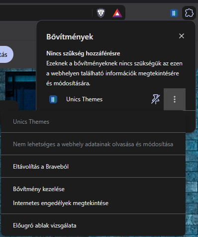
   *Brave: kitűzés az eszköztárra és eltávolítás*
   
7. Nyisd meg az Unics oldalt, és válassz témát (8. fejezet).

> ℹ️ **Vivaldi, Opera és más Chromium-böngészők**  
> Ezekben ugyanígy működik a kicsomagolt betöltés (a cím `vivaldi://extensions`, ill. `opera://extensions`). Ezeket nem teszteltük.

## 8. Használat

1. Nyisd meg az Unics oldalt, és kattints a bővítmény ikonjára.
2. **Színek:** válassz a témák közül (Világos, Többszínű, Rózsaszín, Sötét). A kis előnézet mutatja a színeket.
3. **Stílus:** legörgetve válassz formát: Klasszikus (az eredeti), Modern, Üveg, Szigetek vagy Brutalista.
4. A kettő szabadon kombinálható, a változás azonnal látszik, és a böngésző bezárása után is megmarad.
5. **Funkciók:** a popup alján három kapcsoló van (induláskor a Színterek oldalra; csoportok alapmódja; emlékezés a csoportokra). Mindegyik mellett egy **ⓘ** jel magyarázza, mit csinál. Alapból mind ki van kapcsolva.

> ℹ️ **Vissza az eredetihez**  
> Válaszd a **Világos → Eredeti** színt és a **Klasszikus** stílust: az oldal pontosan úgy néz ki, mint a bővítmény nélkül.

## 9. Amikre figyelj

- **Chrome, Edge, Brave:** a kicsomagolt mappát **ne töröld, ne nevezd át és ne helyezd át**. Ha mégis, a bővítmény hibával kikapcsol; tedd vissza, vagy töltsd be újra.
- **Ne csomagold a Letöltések mappába**, mert ott könnyen kitörlődik. Állandó helyet válassz.
- **Chrome/Edge figyelmeztetés:** indításkor megjelenhet egy üzenet a „fejlesztői módú bővítményekről”. Ez normális, bezárhatod, a bővítmény működik.
- **Firefox:** az Engedélyezés gombot egyszer kell megnyomni. Utána minden Unics-oldalon működik.
- **Frissítés kézzel** (Chrome, Edge, Brave): lásd a következő fejezetet.
- Csak a **unics.szte.hu** oldalon látszik a hatása. Más weboldalakat nem változtat.

## 10. Frissítés

**Firefox:** automatikus, nem kell tenned semmit.

**Chrome, Edge, Brave:**

1. Töltsd le az új `…-chromium.zip` fájlt a Releases oldalról.
2. Csomagold ki **ugyanabba a mappába**, a régi fájlok fölé (felülírás).
3. Nyisd meg a bővítménykezelőt, és kattints az Unics Themes kártyán az **Újratöltés** (⟳) gombra.
4. Az Unics oldalon nyomj egy F5-öt.

## 11. Hibaelhárítás

| Mi a gond? | Megoldás |
|---|---|
| Nem változik az oldal kinézete | Firefoxban nyomd meg a popupban az **Engedélyezés** gombot, vagy az ikon jobb klikk menüjében válaszd a **Mindig engedélyezve a következőkön: unics.szte.hu** lehetőséget. Nyomj F5-öt. Ellenőrizd, hogy a `unics.szte.hu` oldalon vagy-e. |
| Az Engedélyezés gomb nem tűnik el (Firefox) | Kattints rá újra, és a böngésző kérdésére válaszolj **Engedélyezés**-sel. Ha így sem megy, indítsd újra a Firefoxot. |
| Újraindítás után eltűnt a bővítmény (Chrome/Edge/Brave) | Valószínűleg a kicsomagolt mappa törlődött vagy elmozdult. Csomagold ki újra egy állandó helyre, és töltsd be. |
| Hibajelzés a bővítménykártyán | Nyisd meg a Hibák gombot, és küldd el a szöveget a GitHub Issues oldalon. Próbáld meg az Újratöltés gombot is. |
| Valami rosszul néz ki (olvashatatlan szöveg, fehér doboz) | Készíts képernyőképet, és írd meg, melyik téma és stílus. Addig válts másik témára. |
| Lassú az oldal | Az Üveg stílus (elmosás) gyengébb gépen terhelőbb lehet. Válts Modern vagy Klasszikus stílusra. |

## 12. Eltávolítás

Az eltávolítás után az oldal visszaáll az eredeti kinézetre, és a bővítmény minden adata törlődik a böngésződből.

1. **Firefox:** jobb klikk a bővítmény ikonján → **Kiegészítő eltávolítása** (vagy `about:addons` → **…** → **Eltávolítás**).

   
   *Firefox: az ikon menüje: hozzáférés az Unics oldalhoz, kitűzés, eltávolítás*
   
2. **Chrome:** puzzle ikon → az Unics Themes melletti **⋮** → **Eltávolítás a Chrome-ból** (vagy `chrome://extensions` → **Eltávolítás**).

   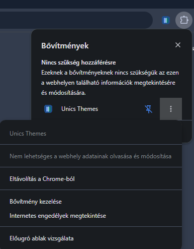
   *Chrome: a bővítmény eltávolítása*
   
3. **Edge:** Bővítmények (puzzle) menü → **⋯** → **Eltávolítás a Microsoft Edge-ből**.

   
   *Edge: kitűzés az eszköztárra és eltávolítás a bővítmények menüjéből*
   
4. **Brave:** puzzle ikon → az Unics Themes melletti **⋮** → **Eltávolítás a Brave-ből**.

   
   *Brave: kitűzés az eszköztárra és eltávolítás*
   
5. Chrome/Edge/Brave esetén ezután a kicsomagolt mappát is törölheted.

## 13. Licenc, hibabejelentés

- **Licenc:** PolyForm Noncommercial 1.0.0. Szabadon használható, másolható és módosítható **nem kereskedelmi célra**, de pénzt keresni vele nem lehet. A betűtípusok (Inter, Manrope) az SIL OFL licenc alatt állnak.
- **Nem hivatalos** projekt, nem áll kapcsolatban az SZTE-vel vagy az Unics / CooSpace fejlesztőivel.
- **Hibát találtál, vagy ötleted van?** Írj a GitHub **Issues** oldalon: `https://github.com/zoltan-234/coospace5-egyedi-temak-szte/issues`. Képernyőképet is csatolhatsz.
- A kód nyilvános: `https://github.com/zoltan-234/coospace5-egyedi-temak-szte`

